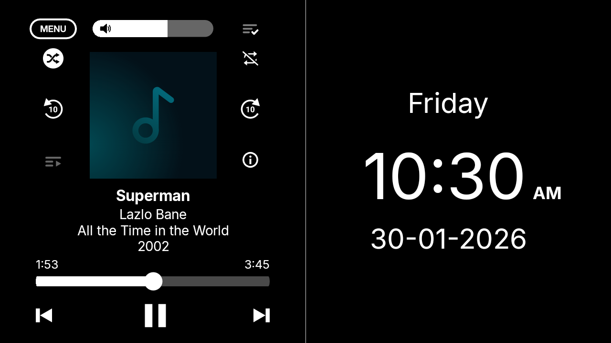
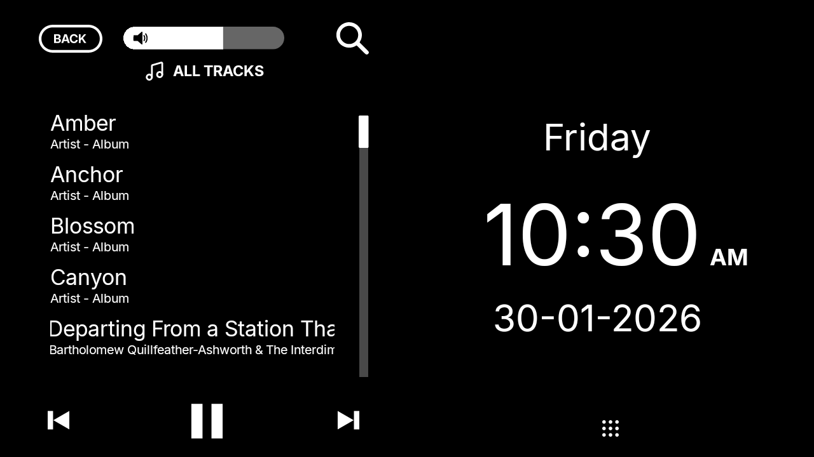
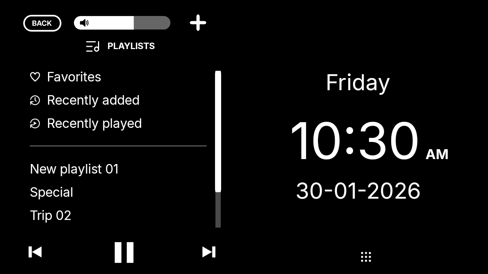
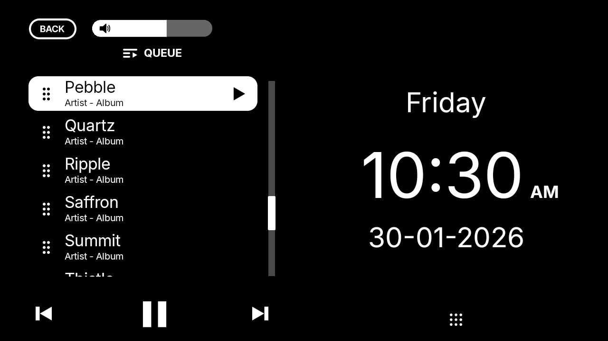
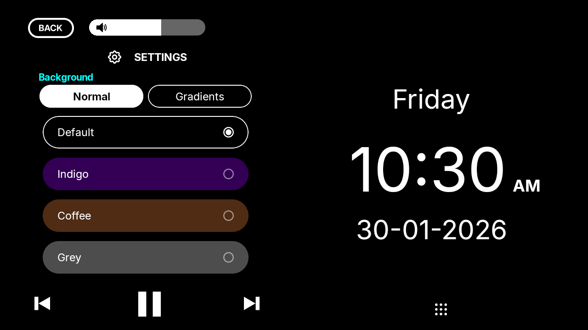

<p align="center">
  
</p>

<h1 align="center">Clocarmus</h1>

<p align="center">Your music and a big, clear clock. Ready for your Android car screen.</p>

Clocarmus is an offline music player and clock for Android car head units. Play music from your own folders, browse your collection, and keep the time in view on one simple landscape screen.

It runs on **Android 6.0 and newer**, with no account, internet connection, or Google Play Services required.

**[Download the APK from GitHub Releases](https://github.com/smishberma/Clocarmus/releases).**



## What you can do

- **Play your own music.** Add folders from internal storage, USB drives, or SD cards accessible through Android's folder picker.
- **Find a song quickly.** Browse tracks, artists, albums, genres, folders, and playlists, with search in the music browsers.
- **Keep your favorites together.** Save favorite songs, create playlists, and find recently added or played music.
- **Control what plays next.** Reorder the queue, use shuffle and repeat, seek within a song, or skip backward and forward by 10 seconds.
- **Keep listening in the background.** Return to the app without interrupting your music. After an app restart, your saved queue and position return paused, ready for Play.
- **Make it yours.** Choose backgrounds, clock styles, a 12- or 24-hour clock, and a layout for right-hand-drive cars.

The clock stays visible while you browse. Your library and settings are stored locally; Android may back them up or transfer them according to your device settings. Removing a music source from the app leaves your music files untouched.

## Screenshots

| Music library | Playlists and favorites |
| --- | --- |
|  |  |

| Playback queue | Appearance settings |
| --- | --- |
|  |  |

*Captured from the Android app. Song titles and playlists are examples; music is not bundled.*

## Start listening


1. Download the APK from [GitHub Releases](https://github.com/smishberma/Clocarmus/releases) to your Android device.
2. Open the APK to install it. If Android asks, allow your browser or file manager to install apps from this source.
3. Open **Clocarmus** and follow the welcome screens.
4. Allow music access when asked, then choose the folders containing your songs.
5. Let the library scan, select a song, and tap **Play**.

To add or remove folders later, open **Menu → Settings → Manage folders**. Use **Manual rescan** to refresh your library after changing its files.

Open **Menu → Settings → About** to read the privacy policy and open source license notices. Both documents are bundled with the APK and available offline.

## Build from source

Open this project in Android Studio with **Android SDK Platform 35** and a Gradle JDK compatible with the checked-in build tooling. Set the SDK location through Android Studio, `ANDROID_HOME`, or your local `local.properties`.

Build the APK with the included Gradle wrapper:

```sh
./gradlew :app:assembleDebug
```

The APK is saved to `app/build/outputs/apk/debug/app-debug.apk`. To install it on a connected device or running emulator:

```sh
./gradlew :app:installDebug
```

Clocarmus is built with Kotlin and Jetpack Compose. For development instructions, see [AGENTS.md](AGENTS.md). Technical details live in the [compatibility and runtime notes](docs/compatibility-and-contracts.md), [shuffle documentation](docs/genuine-shuffle.md), and [asset credits](design/ASSETS.md).
