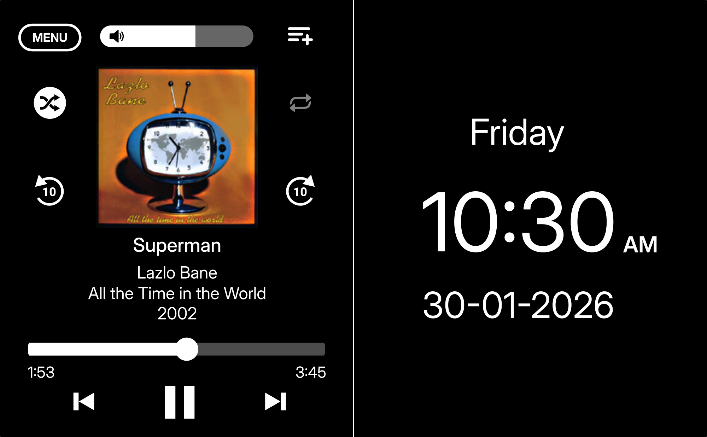

# Clocarmus

Clocarmus is a planned offline music player for aftermarket Android car infotainment systems, built with **Kotlin and Jetpack Compose**. It combines local music playback with a large digital clock in a landscape interface designed for car screens.

The app is intended to run on **Android 6.0 (API 23) and above**, install through an APK, and operate without accounts, cloud services, an internet connection, or Google Play Services.

## Current status

**Main player, menu, and All Tracks visual shells implemented.** The app renders the reference player with bundled Inter fonts, the supplied SVG artwork placeholder and sample metadata, a live clock/date, full-screen landscape layout, seek and media-volume sliders, and local transport/shuffle/repeat state. Music playback, library discovery, playlists, other category screens, and settings are not connected yet. The Menu button opens the supplied six-category menu; Back or Android Back returns to the player while preserving local transport state. All Tracks opens a searchable, alphabetically sorted demo library of 28 English titles, from Amber to Zenith. Other categories and Settings open placeholder dialogs. Play/pause currently changes the visual control state; it does not play audio. Normal launch starts paused.

The first release will be a personal-use APK validated on an Android Virtual Device (AVD) with 100 tracks. Physical head-unit testing will follow. There will be no artificial library import limit, but larger-library performance is not yet validated.

See [PLAN.md](PLAN.md) for agreed requirements, implementation phases, acceptance criteria, assumptions, and open risks.

## Planned experience

### Player and clock

- Full-screen, landscape-only interface with a fixed 50/50 split.
- Left side: album artwork, track title, artist, album, year, and playback controls.
- Right side: persistent digital clock, day, and date with configurable formats.
- Browsing and settings replace the left-side content while the clock and playback controls remain available.
- After selecting a song, return to the main player after 15 seconds of inactivity. Editing playlists, typing in search, or entering settings cancels that return.
- Keep the screen awake while the app is visible.
- Black, dark gray, dark blue, and dark burgundy background presets, with Inter typography and high-contrast controls.

### Local music library

- Read music from selected folders on internal storage and accessible USB drives or SD cards, including subfolders.
- Remember selected sources, refresh on detected reconnection, and offer manual rescanning.
- Browse tracks, artists, albums, genres, folders, and playlists; search songs, albums, and artists.
- Create, rename, delete, and reorder playlist tracks; mark favorites through immediately saved membership controls.
- Show up to 100 recently added tracks and 100 recently played distinct tracks.
- Preserve unavailable tracks and playlist references when a drive disconnects, and recognize renamed or moved files where identity can be established safely.
- Keep identical copies at different storage locations as separate entries.
- Remove selected sources only after confirmation, without deleting music files.

### Playback

- Target formats: MP3, M4A containing AAC, OPUS, FLAC, OGG Vorbis, and WAV.
- Background playback, seeking, 10-second backward/forward controls, shuffle, repeat one, and repeat all.
- Play the selected collection in displayed order, including all matching songs for search results.
- Control Android media volume and respond to supported steering-wheel/media controls.
- Restore the selected track, position, queue, shuffle order, and repeat mode **paused** after restart or sleep.
- Leave an ongoing background playback session unchanged when returning to the app.
- Temporarily lower volume for navigation prompts; pause for calls or another music app and wait for explicit Play afterward.
- Skip unplayable queued tracks with a brief message; pause if the drive holding the current track is removed.
- Attempt automatic UI launch after boot without starting playback, where the device permits it.

### Offline operation and diagnostics

All library data, preferences, and playback state will stay on the device. Local diagnostics will support manually exported text reports, with no automatic uploads and file paths omitted by default.

Streaming, cloud sync, accounts, online metadata/artwork lookup, metadata editing, portrait layouts, image backgrounds, and playlist/favorites import/export are outside v1. Crossfade, equalizer, and guaranteed gapless playback are deferred.

## Design references

The [design directory](design/) contains the screen mockups and branding assets:

- [Main player](design/01-main-player.png): primary visual reference.
- [App design overview](design/app-design-ref.png): onboarding, browsing, playlist, and settings flows.
- [Design system](design/design-system-ref.png): typography, colors, icons, and controls.



*Design reference, not a screenshot of the current implementation.*

## Development setup

### Current configuration

| Setting | Value |
| --- | --- |
| Language / UI | Kotlin / Jetpack Compose |
| Application ID and namespace | `com.example.clocarmus` |
| Minimum Android SDK | 23 (Android 6.0) |
| Compile / target SDK | 35 |
| Java source / target compatibility | 17 |

Dependency versions are declared in [gradle/libs.versions.toml](gradle/libs.versions.toml). Exact playback, persistence, and background-work dependencies will be verified for Android 6 compatibility before implementation.

### Run in Android Studio

1. Open the project directory in Android Studio.
2. Configure an Android SDK installation with Platform 35 and a Gradle JDK compatible with the checked-in build tooling.
3. Let Gradle sync and install any requested SDK components.
4. Select an AVD or connected Android device and run the `app` configuration.

The current app displays the main player visual shell. The offline requirement applies to the finished app; initial development setup may need internet access to download dependencies and SDK components.

### Build from the command line

Configure the Android SDK using `ANDROID_HOME` or `sdk.dir` in your local `local.properties`, and use a JDK compatible with the checked-in Gradle and Android Gradle Plugin versions.

```sh
./gradlew assembleDebug
```

Debug APK output:

```text
app/build/outputs/apk/debug/app-debug.apk
```

To install on a running emulator or connected device:

```sh
./gradlew installDebug
```

Use the checked-in Gradle wrapper. Keep `local.properties`, generated build directories, and signing secrets out of version control.

## Project layout

```text
app/src/main/          Android manifest, Kotlin source, and resources
app/src/main/java/com/example/clocarmus/
                       App entry point and Compose theme
design/               UI mockups, design system, and logo assets
gradle/               Gradle wrapper and dependency version catalog
PLAN.md               Agreed specification and implementation plan
```

## Validation and device limitations

Initial acceptance testing will cover 100 mixed-format tracks, nested folders, missing metadata, unavailable sources, playlists, background playback, paused restoration, and the fixed landscape layout on minimum and modern Android AVDs.

Real USB/SD behavior, steering-wheel controls, ignition and sleep cycles, boot launch, audio interruptions, and OEM process management require physical head-unit testing. Boot launch is a best-effort convenience, not a universal compatibility guarantee. Codec variants, file-identity ambiguity, and performance on low-powered hardware remain validation risks documented in [PLAN.md](PLAN.md).

## Main-player inactivity fading

On the active player, Menu, Add to playlist, Shuffle, Repeat, and both 10-second skip controls fade to 20% opacity over 500 ms after 10 seconds without touch. Other elements retain their normal appearance. A touch on either pane restores the controls immediately and still performs its normal action. Holds, drags, and multiple fingers keep them visible until the last release.

Dialogs and backgrounding suspend and reset the timer; dismissal or foreground return starts a fresh interval. The timer is transient, independent of playback and hardware keys, and disabled in static reference previews. Run the timing/cancellation tests with `./gradlew testDebugUnitTest`.

## Main screen visual comparison

Build with `./gradlew assembleDebug`, start the **headunit_a6** AVD, then run:

```sh
python3 scripts/compare-main-player.py --install
```

The script requires `adb` and Python Pillow. It checks the AVD name, installs the APK when requested, and opens the debug-only `reference_preview` fixture with the mockup's Friday / 10:30 AM / 30-01-2026 clock and sample progress. Normal launches use the device clock. Seek progress consistently reflects elapsed time divided by duration, including in the comparison fixture.

Artifacts are saved under `build/visual-comparison/final/`: the AVD screenshot, reference resized to the display dimensions, pixel difference, side-by-side comparison (reference left), and raw mean RGB difference. The 2000×1236 mockup is fitted proportionally inside each half of the AVD's native 1280×720 screen. The screen uses one uniform scale per half, square artwork, and proportional SVG icons. Text has no horizontal/vertical transforms; long clock values shrink by font size if needed. The artwork placeholder and supplied icons intentionally differ from the original mockup, so pixel differences are a visual aid rather than an acceptance threshold.

See [asset provenance and font license](design/ASSETS.md). The player uses `design/assets/main-player/no-album-art.svg` as its artwork; no audio track is bundled.

## Menu screen visual comparison

```sh
./gradlew assembleDebug
python3 scripts/compare-main-player.py --screen menu --install
```

This uses `design/02-menu-screen.png`, the same proportional fitting and fixed clock fixture as the player comparison, and the supplied vectors in `design/assets/menu-page/`. Artifacts are saved under `build/visual-comparison/menu/`. Normal launch still opens the player; the menu fixture requires a debug build and `reference_preview=true` with `menu_preview=true`.

The menu shares media volume, transport state, and the persistent clock with the player. Player fading resets when the menu opens and restarts on returning. All Tracks opens the demo track menu, Artists opens the artist browser, and Albums opens the album browser; other library categories and Settings remain placeholders.

Regenerate only the menu vectors with `python3 scripts/import-player-assets.py --group menu-page`. The importer also accepts `--group main-player` and `--group shared`; complex SVG filters are rejected by Android's vector converter and require separate asset preparation.

Validated on `headunit_a6` at 1280×720: menu screenshot comparison, all category controls exposed, category/Settings dialog dismissal, play/pause preserved through navigation, and both Back actions. `assembleDebug`, `testDebugUnitTest` (11 tests), and `lintDebug` pass. Pixel comparison remains a review aid; supplied SVG details and Inter rendering differ from the raster mockup.

Menu category icons, Back, and Settings use their supplied normal/pressed SVGs while held; releasing or dragging outside restores their normal state. Play, Pause, Previous, and Next use their supplied shared pressed SVGs while held on the player, menu, and All Tracks screens; release or cancellation restores the normal asset. Genres is centered directly below Artists. The updated artwork SVG is bundled as an Android vector with its gradients preserved; regenerate it with `python3 scripts/import-player-assets.py --group main-player --asset no-album-art`.

## Track menu

Menu → All Tracks opens the screen based on `design/03-track-screen.png`, using the existing uniform scale, fixed 50/50 split, bundled Inter, and supplied SVGs. The 28 fixed sample titles cover A–Z, with two A and two S titles. They exercise the scroll window without requiring audio files or storage access.

Swipe the list to move the scrollbar, drag the white pill to scroll quickly, or tap the rail to jump. A letter bubble follows the pill during scrolling; dragging beyond either endpoint clamps at the beginning/end. Search filters the sample titles and Show all clears the filter. A list that fits the window has no draggable pill. The scrollbar also supports accessibility progress actions.

Each row shows its title above an Artist - Album metadata line (demo placeholders). On the main player, Year remains directly below Album after selection and track changes; demo entries use a Year placeholder, while missing real year metadata displays Unknown year. Selecting a row gives it a white background with black text and a black play/pause indicator, and updates the player's demo title/queue. Previous/Next follow the displayed collection captured at selection; Play/Pause updates the selected row indicator. Screen Back and Android Back return through menu → player. Scroll position, search, and selection survive that navigation. Playback remains a visual demo; no audio is connected yet.

```sh
./gradlew assembleDebug testDebugUnitTest lintDebug
python3 scripts/compare-main-player.py --screen tracks --install
```

The debug fixture uses `reference_preview=true` and `tracks_preview=true`. Screenshots and proportional comparisons are saved to `build/visual-comparison/tracks/`; the raster reference has different titles from the demo list. Regenerate the two new vectors with `python3 scripts/import-player-assets.py --group track-menu`.

## Return to player after selection

Selecting a track keeps browsing open, then returns directly to the player after 15 seconds without interaction. Taps anywhere (including the clock), transport/volume actions, keyboard input, and scrolling reset the countdown. Holds and ongoing scroll gestures/flings postpone it until the final release/scroll stop.

Typing in search or entering Settings/Playlists cancels the return until another track is selected. Opening the search dialog without typing suspends the countdown; closing it starts a fresh interval if still armed. Backgrounding also suspends it and foregrounding starts a fresh interval. Manual return to the player disarms it, so reopening the menu alone cannot schedule another return. The timer is transient across recreation and independent of main-player control fading; returning starts that screen's normal fading interval.

Run `./gradlew testDebugUnitTest` for exact-deadline, reset, cancellation, scrolling, multi-touch/hold, lifecycle suspension, and rearming checks.


## Artists flow

Menu → Artists opens the artist list; tapping a name opens its detail pane with Play all and Browse → Tracks / Albums. All four panes share the existing fixed split, clock, volume, transport, Inter typography, and list controls. Track Artist tags determine grouping; distinct album titles determine counts, with Unknown artist / Unknown album / Unknown year fallbacks. Disconnected entries remain in the groups. This is a demo shell with separate artist fixtures; the real offline library and audio service are still pending.

Search filters the current field (artist name, song title, or album title). Back and Android Back follow Tracks/Albums → artist detail → Artists → Menu. Queries and scroll positions are retained per list and artist, and the last-opened artist stays highlighted independently of the selected track. Album taps open shared album options for the whole album, including compilation performers. Individual track selection queues the displayed matching tracks and arms the existing 15-second return. Play all queues the artist's tracks alphabetically, disables shuffle, selects the first available entry, and returns immediately to the player. Queue selection uses track IDs so the same title in different artists' fixtures stays distinct.

```sh
./gradlew assembleDebug testDebugUnitTest lintDebug
python3 scripts/compare-main-player.py --screen artists --install
python3 scripts/compare-main-player.py --screen artist-detail
python3 scripts/compare-main-player.py --screen artist-tracks
python3 scripts/compare-main-player.py --screen artist-albums
```

Comparisons are saved under `build/visual-comparison/<screen>/`. These debug-only fixtures reproduce Ripple and the mockups' visible Pebble–Summit rows; the album preview uses a separate sample collection to reproduce the supplied years (the artist-list mockup specifies one Ripple album while the album mockup shows several). Normal browsing uses consistent artist groups and album counts. The comparison script settles each preview after immersive-mode resizing. Supplied vectors, font rasterization, the screen divider, and a scrollbar positioned from the actual collection length introduce small differences from the PNGs.

Validated on `headunit_a6` (API 23, 1280×720): all four screenshot comparisons; Menu navigation; artist-scoped search and query restoration through Back, player return, and reentry; exact artist/track scroll restoration; last-opened artist highlighting; album highlighting; delayed individual-track return; immediate Play all return and queue advancement. The unit suite has 32 passing tests, including grouping, distinct album counts with unavailable copies, metadata fallbacks, alphabetical ordering, stable IDs, and existing inactivity/scroll checks. `assembleDebug` and `lintDebug` pass.

Artist options uses the supplied normal/pressed SVG pairs for Play all, Tracks, and Albums. Holding a button changes its icon to the supplied pressed color; release or cancellation restores the normal icon. Labels stay white, and actions run on release, matching Back and transport controls.


## Albums flow

Menu → Albums opens an alphabetical list with effective Album Artist, year, and song count. Album options provides Play album, Album Tracks, and an Artist shortcut. Album Tracks shows zero-padded numbers and durations in numeric disc/track order. Missing metadata uses Unknown album / Unknown artist / Unknown year, `--`, and `--:--`. Album years use the most frequent known year, earliest on ties. Physical copies and disconnected entries remain in counts.

Albums group by title + effective Album Artist. Artist album rows use the same identity, while main artist counts retain distinct titles. Album taps from Artists open the whole album. The Artist shortcut uses explicit Album Artist scope, including Various Artists; the main Artists menu continues using track Artist. Back retraces the entry path and restores list queries, scroll, and last-opened selection. Search filters album titles or song titles within the current collection; options search opens Album Tracks search.

Play album captures the entire ordered album queue, disables shuffle, starts the first available demo track, and immediately returns to the player. Selecting an individual track captures the displayed matching queue and keeps the existing 15-second return without changing shuffle. Unavailable selections skip only within that queue; an exhausted collection stops. This remains a visual/demo implementation: repository scanning and real audio playback are pending.

```sh
./gradlew assembleDebug testDebugUnitTest lintDebug
python3 scripts/compare-main-player.py --screen albums --install
python3 scripts/compare-main-player.py --screen album-options
python3 scripts/compare-main-player.py --screen album-tracks
```

Comparison artifacts are saved under `build/visual-comparison/<screen>/`. Debug fixtures use `albums_preview=albums`, `album-options`, or `album-tracks` with `reference_preview=true`. The list fixture reproduces the reference album rows, while normal browsing also includes the artist fixtures and a Various Artists compilation. Album Tracks uses a proportional scrollbar thumb; the supplied normal/pressed Album Tracks vectors retain their original geometry and colors.

Validated on `headunit_a6` (API 23, 1280×720): three reference comparisons; Menu Albums entry; scoped album search and filter restoration through Back; numbered/duration rows; options search opening Album Tracks search; individual selection remaining in browsing; immediate Play album return at track 1; Artist shortcut and Back to album options; an artist album opening both performers of a compilation; Various Artists scope and Back to the originating artist. All 38 unit tests pass, including album identity, metadata fallbacks, year ties, numeric disc/track ordering, disconnected copies, scope separation, filtered ordering, and finite unavailable selection. `assembleDebug` and `lintDebug` pass. Real audio and physical-head-unit behavior remain unvalidated.

## Long music titles

Overflowing track, artist, and album text scrolls automatically on the player and all track, artist, and album browsing screens, including options headings and row metadata. Each marquee pauses for 1.5 seconds before scrolling and between continuous loops. Text that fits stays still; long text keeps its original font size and stays clipped inside its label, clear of playback indicators and the clock. Changing a title restarts its marquee from the beginning.

The demo library includes **Departing From a Station That Was Demolished Before It Was Ever Built**, by **Bartholomew Quillfeather-Ashworth & The Interdimensional Orchestra**, on **The Unabridged and Occasionally Contradictory Chronicles of Seventeen Thousand Midnight Trains**. Find it through All Tracks, Artists, or Albums to exercise long labels throughout each flow; select it to view all three marquees on the main player. Existing reference artist fixtures keep their original metadata.
